# Proof dependency graph

ノードの分類:

- **[L]** Lean theorem（本プロジェクトで証明、commit `54dc740`）
- **[F]** previously formalized theorem（Foundation `dfaa003d` / Mathlib）
- **[M]** unformalized mathematical assumption or argument（紙上の証明・標準的事実）
- **[P]** philosophical axiom / claim（数学的に証明しない）

```mermaid
graph TD
  %% Foundation (previously formalized)
  F_G2["[F] consistent_unprovable<br/>(Gödel II, Δ₁-presented T ⊇ IΣ₁)"]
  F_strict["[F] instance T ⪱ T ∪ T.Con"]
  F_ded["[F] deduction_iff"]
  F_sound["[F] SoundOnHierarchy, models_of_provable"]
  F_stdcon["[F] standard_consistent<br/>(ℕ ⊧ Con_T ↔ Consistent T)"]
  F_height["[F] height_union_incon_eq_one"]
  F_turingω["[F] exists_prenex_axiomatization_turingOmega"]
  F_box["[F] models_boxBot_iff,<br/>height_eq_top_of_sigma1_sound"]
  F_HBL["[F] ProvabilityAbstraction: HBL, mono, D1"]
  F_lob["[F] formalized_unprovable_not_con<br/>(Löb)"]
  F_stdprov["[F] models_standardProvability_iff,<br/>con_unrefutable, con_unprovable"]
  F_mathlib["[F] Mathlib: ℝ, ℂ, Complex.I"]

  %% Phase 1
  P11["[L] provable_mono"]
  P12["[L] unprovable_of_refuted,<br/>not_models_of_refuted,<br/>not_models_and_models_neg"]
  P13["[L] real_not_models_rootSentence,<br/>complex_models_rootSentence,<br/>theoryOf_real_not_subset_complex"]
  F_sound --> P12
  F_mathlib --> P13

  %% Phase 2
  G1["[L] G1_unprovable, G1_strict"]
  F_G2 --> G1
  F_strict --> G1
  L21["[L] ISigma1_le_ascent"]
  L22["[L] Stage.sigma1Sound_next"]
  F_ded --> L22
  F_sound --> L22
  F_stdcon --> L22
  L23["[L] sigma1Sound_ascent, consistent_ascent"]
  L21 --> L23
  L22 --> L23
  G2["[L] G2_unprovable, G2_strict, G2_strict_of_lt"]
  G1 --> G2
  L21 --> G2
  L23 --> G2
  G2s["[L] consistent_union_incon,<br/>inconsistent_next_of_union_incon,<br/>not_sigma1Sound_union_incon"]
  G1 --> G2s
  F_height --> G2s
  L22 --> G2s
  G3b["[L] models_conItr, models_Conω,<br/>models_ascent, models_iUnion_ascent"]
  F_box --> G3b
  G3["[L] G3"]
  F_turingω --> G3
  G3b --> G3
  G1 --> G3
  G4["[L] G4, Eligible.iterate_next,<br/>not_exists_eligible_proves_all_truths"]
  G1 --> G4
  L22 --> G4

  %% Phase 3 (preliminary)
  M12["[L] disjProv, disj_HBL, disj_con_iff"]
  F_HBL --> M12
  M45["[L] standard_disj_models_iff,<br/>standard_disj_con_not_implied,<br/>standard_disj_con_unprovable"]
  M12 --> M45
  F_lob --> M45
  F_stdprov --> M45

  %% Unformalized mathematics
  M_presentation["[M] Pr_{α'} ↔_T □ ∨ □¬Con<br/>(presentation ↔ predicate)"]
  M_rfn["[M] RFN_Σ₁(T) not T-equivalent<br/>to any Π₁ sentence"]
  M_ded["[M] formalized deduction theorem<br/>Con(Tₙ) ↔ ¬□_T^{n+1}⊥"]
  M_turing["[M] Turing 1939 / Feferman 1962<br/>completeness of transfinite progressions"]
  M45 -.-> C2["C2: made-canonicity does not fix Con"]
  M_presentation -.-> C2
  M12 -.-> C4["C4: D1–D3 do not force Σ₁"]
  M_rfn -.-> C4
  M_ded -.-> G3id["⋃ₙ Tₙ ≊ T_ω (not proved)"]

  %% Philosophical claims (not derived)
  P_axiom["[P] meaning-dimension generation is infinitely possible (§2.3)"]
  P_gd["[P] generative dialetheism (§3.1)"]
  P_mc["[P] made-to-making asymmetry justifies made-canonicity (§3.5)"]
  P_someday["[P] every question handled someday (§3.3)"]
  P_llm["[P] LLMs cannot generate meaning dimensions (§7.2)"]
```

## 読み方

- 実線の矢印は Lean の証明で実際に使った依存。破線は紙上の議論での依存。
- **[P] ノードにはどの [L] ノードからも矢印が入っていない。** G4 は §3.4(iv) の「Mathematically: Σ₁-soundness propagates, and the process iterates」を、Δ₁ 表示された算術理論について検証したものであり、[P] の主張を導いたものではない。
- G3 は Foundation の T_ω（`T ∪ T.Conω`）に対する定理であり、本プロジェクトの `ascent` の合併 `⋃ₙ Tₙ` との同一視は [M] に依存して未証明。
